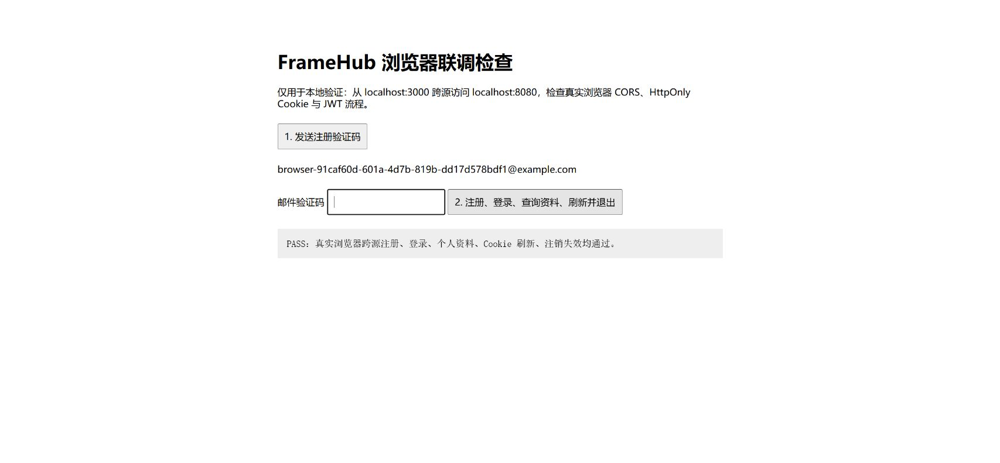

# 验证记录

验证日期：2026-10-17（Asia/Shanghai）。

## 自动化测试

实际执行（指定工作区 Maven 缓存，避开沙箱对用户目录的写限制）：

```powershell
$env:JAVA_HOME='C:\Program Files\Java\jdk-21'
mvn -B -ntp '-Dmaven.repo.local=D:/FrameHub/.tools/repository' package
```

结果：BUILD SUCCESS。

| 测试类 | 数量 | 失败 | 错误 | 跳过 |
|---|---:|---:|---:|---:|
| SecurityUnitTest | 3 | 0 | 0 | 0 |
| UserCenterIntegrationTest | 14 | 0 | 0 | 0 |
| GatewayIntegrationTest | 6 | 0 | 0 | 0 |
| 合计 | 23 | 0 | 0 | 0 |

用户集成测试实际启动 Testcontainers MySQL、Redis、MinIO。Gateway 实际启动 Netty HTTP 下游。SMTP 在此测试套件中使用测试专用发送器，真实 SMTP 由下述端到端测试覆盖。

## 迁移与部署配置

- 用户服务实际启动并成功执行 Flyway V1，创建三张业务表及 schema history。
- 实际访问 `/v3/api-docs`，导出14条路径、16个方法操作至 `docs/openapi.json`；离线快照补充网关入口与 Bearer 安全方案。
- `docker compose -f compose.yml config --format json` 校验：user-service、MySQL、Redis 无 ports；用户服务强制 production profile。
- `git diff --check` 通过；`.env`、依赖缓存、构建产物与日志被 Git 忽略。

## 环境问题与处理

- 官方 MinIO Docker Hub、Quay 镜像拉取失败；官方发布文件返回410。改为可成功拉取的固定摘要 `coollabsio/minio` 镜像，mc 使用同一镜像内的命令。
- 本机6379端口无法绑定，开发 Redis 端口改为可配置的16379。
- 本机到 Mailpit 的 SMTP 端口映射存在握手超时，容器内 SMTP 正常；实际业务闭环使用全 Compose 部署验证。开发者遇到同类问题时优先使用全容器模式。
- 首次容器构建下载依赖较慢，Dockerfile 使用只含正式依赖的 Maven Central 配置与 BuildKit Maven 缓存。

生产公网的 HTTPS、SMTP 投递、防火墙、对象存储入口没有实际部署；当前检查只证明仓库部署配置未发布用户服务端口。

## 全容器与端到端验证（已通过）

实际执行：

```powershell
docker compose -f compose.yml -f compose.local.yml build
docker compose -f compose.yml -f compose.local.yml up -d
python scripts/smoke.py
```

两个服务镜像均构建成功。Dockerfile 构建阶段使用 `-DskipTests`；自动化测试已在前述 Maven package 中独立执行且全部通过。
烟雾脚本实际输出：

```text
PASS: Gateway CORS, SMTP code, register, login cookie, profile, creator, MinIO direct upload, refresh, logout revocation
```

确认了真实 SMTP 邮件与 MinIO 上传，并检验 Gateway 和 MinIO 的 CORS 预检。
实际 `docker compose ps`：Gateway 仅发布 `127.0.0.1:8080->8080`；user-service 没有任何宿主端口映射；开发依赖端口只绑定127.0.0.1。

## Chrome 真实前端验证（已通过）

从 `http://localhost:3000/browser-check.html` 使用浏览器 fetch 跨源访问 `http://localhost:8080`。
使用测试邮箱接收 Mailpit 验证码，依次完成注册、登录、个人资料查询、HttpOnly Cookie 刷新、注销，并确认注销后的 JWT 得到401。

页面实际显示：`PASS：真实浏览器跨源注册、登录、个人资料、Cookie 刷新、注销失效均通过。`



重复浏览器验证：在项目根目录运行 `python -m http.server 3000 --bind 127.0.0.1 --directory scripts`，打开联调页面，在 Mailpit 读取测试邮箱验证码后完成流程。该页面仅为开发验证工具，不是业务前端。
